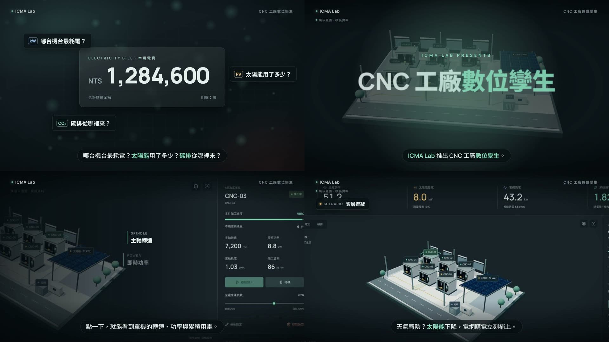

# Product Promo Video Skill: let an AI agent turn your system into a professional promo video

**English** | [繁體中文](https://github.com/nutcelvischen-jpg/product-promo-video-skill)

Give the AI a product that runs in a browser (website, dashboard, 3D digital twin, SaaS). It will:

1. **Use the product first**, find what's worth filming and what to fix
2. **Write an agency-style script** (pain → reveal → features → scenarios → value → sign-off)
3. **Capture real footage frame by frame** (even 3D / WebGL at a smooth 30 fps)
4. **Add motion design**: push-ins, callouts, transitions, big type, logo end card
5. **AI voice-over**, Apple Loops music, synthesized SFX, a proper mix
6. Render a **1080p MP4**



> Example: CNC factory digital twin promo (90 s, enterprise audience, signed ICMA Lab) — `examples/cnc-twin/`

This is an **Agent Skill** (`SKILL.md`) for Google Antigravity, Claude Code and other skill-capable agents. It builds on [motion-video-skill](https://github.com/nutcelvischen-jpg/motion-video-skill/tree/en) — **install both**.

## 1. Setup (~15 min)

Needs **Python 3.9+**, **Git**, **ffmpeg**, internet. Music from Apple Loops needs a **Mac** (otherwise bring licensed music).

```bash
git clone -b en https://github.com/nutcelvischen-jpg/motion-video-skill .agents/skills/motion-video
git clone -b en https://github.com/nutcelvischen-jpg/product-promo-video-skill .agents/skills/product-promo-video
brew install ffmpeg            # Windows: winget install ffmpeg
pip3 install -r .agents/skills/product-promo-video/requirements.txt
python3 -m playwright install chromium
```

TTS key (OpenRouter → Keys). **Keep it on your machine — never paste it to the AI or into the project:**
```bash
echo 'OPENROUTER_API_KEY=sk-or-...' > ~/.openrouter.env && chmod 600 ~/.openrouter.env
```

## 2. Use it

Serve your product (e.g. `npm run build && cd dist && python3 -m http.server 8766`) and say:

> "Use the product-promo-video skill to turn http://localhost:8766 into a 90-second promo for enterprise clients, English narration, signed by ___ Lab."

The agent will try the product → suggest code tweaks → show you the script → capture → voice → animate → score → render. It stops for **script approval, code-change suggestions, and a listen of the final cut**.

Output: `videos/<name>/out/<name>_en_final.mp4`.

## 3. By hand

```bash
P=.agents/skills/product-promo-video; MV=.agents/skills/motion-video
python $P/scripts/new_promo.py videos/demo --mv $MV
python $P/scripts/capture.py videos/demo/shots.json --out videos/demo/assets/clips --test
python $P/scripts/capture.py videos/demo/shots.json --out videos/demo/assets/clips
set -a; source ~/.openrouter.env; set +a
python $MV/scripts/tts.py videos/demo --lang en
python $P/scripts/align_timeline.py videos/demo --mv $MV --lang en --target 90
python $MV/scripts/render.py videos/demo --preview && python $MV/scripts/render.py videos/demo --sheet
python $P/scripts/music.py videos/demo/music.json --timeline videos/demo/timeline_en.json --out videos/demo/bgm.wav
python $P/scripts/sfx.py videos/demo/sfx.json --timeline videos/demo/timeline_en.json --out videos/demo/sfx.wav
python $MV/scripts/render.py videos/demo --lang en --crf 18
python $P/scripts/mix.py videos/demo --lang en
```
Full guide: [SKILL.md](SKILL.md); details in `references/`.

## 4. Key techniques

| Problem | Solution |
|---|---|
| 3D web apps stutter when recorded without a GPU | **Virtual clock** (`scripts/vt.js`) steps page time frame by frame |
| Actions must match the narration | Actions at fixed frames; animation uses `clip(sel, lineTime - frame/30)` |
| TTS sentence timing is estimated | `align_timeline.py` snaps to real pauses |
| Music should rise and fall with the story | `music.py`: downbeat on the reveal, drums drop under the key line, fade-out — all tied to narration |
| Music buries the voice | `mix.py`: side-chain ducking, loudnorm −15 LUFS |

## License
MIT. Apple Loops may be used in your own productions under Apple's license, but loop files may not be redistributed — so none are included.
